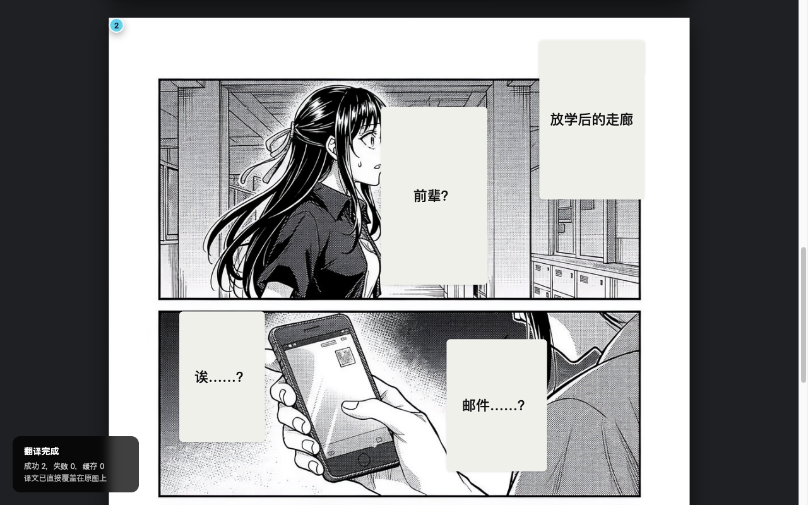

# Manga Translator


[](https://github.com/hibernate-pano/chrome-plugin-manga-translator/actions/workflows/ci.yml)

A Chrome Manifest V3 extension that translates foreign-language manga in your browser.

It calls **any OpenAI-compatible Vision LLM** (OpenAI, Qwen-VL, Gemini via OpenRouter,
SiliconFlow, ...) or a **local model** (Ollama, LM Studio) on demand, then overlays the
translation on top of the original image. The overlay renders inside the page, on top of
the original text bubble, so you can read without leaving your manga site. The picture
around the bubble is left alone; the bubble itself is covered by the overlay.



> **Reading, not just translation.** v0.5.0 added an in-page reading panel that
> lists every translated panel in reading order with numbered anchors on each
> image — a small thing, but the first "this isn't just a translation tool"
> moment for the project.

---

## Quick start

### 1. Install the extension

The extension is not on the Chrome Web Store yet (see [`ROADMAP.md`](./ROADMAP.md)).
For a private build with preloaded credentials:

```bash
git clone https://github.com/hibernate-pano/chrome-plugin-manga-translator.git
cd chrome-plugin-manga-translator
pnpm install
cp .env.example .env
# Fill in the provider values you want to preload, then:
pnpm build
```

For a shareable build with no embedded credentials:

```bash
pnpm build:public
```

Then open `chrome://extensions/`, enable **Developer mode**, click **Load unpacked**
and pick the `dist/` directory. A public build asks the user to enter provider
settings in the extension's Settings page; a private build can be ready on first run.

### 2. Pick a backend

Open the extension's **Settings** page. On first install you'll see a short
onboarding modal:

1. **Welcome** — what this extension does, where your images go.
2. **Ready** — finish and enable translation.

Provider cards let you use preloaded values or enter your own API key, Base URL,
and model. You can skip onboarding and configure later. The extension will not
translate or bill you until you explicitly enable it.

### 3. Translate a page

Open any manga page, click the toolbar icon, then **Translate current page**.

---

## What you get

- **In-place overlay translation**: detected text is replaced with the translation
  while keeping the surrounding art intact.
- **One-click provider presets**: the Settings page lists MiniMax, SiliconFlow,
  OpenRouter, Gemini and OpenAI. One click fills in the endpoint and a
  vision-capable model; your API key stays yours to paste. A wrong model name
  fails on the first request, so the presets are the difference between a
  working first run and a round trip of trial and error.
- **Quality and concurrency you control**: image resolution (1024 / 1536 / 2048)
  and how many images translate at once (1 / 3 / 5) are both in Settings, with
  the cost trade-off spelled out next to each choice. The same lever used to be
  a constant buried in the code.
- **Your target language is actually sent to the model**: Simplified Chinese,
  Traditional Chinese, English, Japanese or Korean — the prompt asks for that
  language, in that language's own idiom rules. The style presets used to be
  Chinese-only, so choosing English still produced Chinese instructions.
- **Three ways to start**: the toolbar button, the right-click menu
  (「翻译当前页面」 for the page, 「翻译这张图片」 for one image), or a keyboard
  shortcut — `Ctrl`/`⌘`+`Shift`+`Y` translate, `+X` re-translate ignoring the
  cache, `+E` clear the overlays, `+S` toggle the reading panel.
- **Auto-continue**: once you have translated a page, images that load later
  (webtoon readers replace them as you scroll) are translated too. The popup
  says so in as many words whenever a page is armed this way — the switches
  in the reading settings are only three of the four things that decide it,
  and the fourth one is the page you just translated by hand.
- **Per-site automation, off by default**: the extension only translates a page
  on its own for sites you add to the auto-translate list from the popup. Every
  other site waits for you to press the button. Automatic translation used to
  fire on every navigation in every tab once the extension was enabled, which
  sent images from whatever you were browsing to your provider and billed for
  them.
- **MiniMax-M3 fast mode**: when the configured model name is MiniMax-M3, the
  request disables that model's thinking mode and asks it to split reasoning
  from the answer, avoiding wasted `<think>` tokens. Other models keep their
  provider's defaults.
- **Reading mode side panel**: an in-page panel pinned to the right edge,
  listing every translation in reading order, with numbered anchors on each
  image. Click a panel entry to jump to the image; click an image badge to jump
  to its panel entry. Every entry can expand to show the source text the model
  read, so a translation you don't trust has something to check it against. The
  panel can be collapsed to its header or closed entirely — from its own ✕
  button, from the popup, or with the keyboard shortcut.
- **A support bundle you control**: Settings has a "copy diagnostics" button
  that builds the version, provider, model and usage counters locally. It
  carries no API key, no endpoint and nothing about the pages you read — you
  decide whether to paste it into an issue. The extension collects nothing, so
  without this a bug report is just "it didn't work".
- **HUD with stages**: scanning → translating → rendering, with cache-hit and
  filtered-image counts surfaced in the completion card.
- **Errors as repair menus**: the failures you can fix in place have a
  fix-it button. Ollama not running? Copy `ollama serve`. CORS blocked? Copy
  `OLLAMA_ORIGINS=chrome-extension://* ollama serve`. Auth failed? Open
  Settings. The ones you cannot fix in place (the provider is down, the image
  host refused) get a sentence that says what to do instead.
- **Local-first**: user-entered config and obfuscated API keys live in
  `chrome.storage.local`. Nothing syncs to your Google account. No telemetry.
  No analytics. (The API key is obfuscated, not encrypted — the salt ships in
  the bundle. The content script is not web-accessible, so a page cannot read
  it out of the shipped extension, but the bundle itself is not a secret.)

---

## Backend options

| Backend | Requires | Privacy | Cost |
|---|---|---|---|
| `OpenAI-compatible` | API Key | images sent to your configured endpoint | pay per token |
| `Ollama` | local install | stays on your machine | free, needs GPU |
| `LM Studio` | local install | stays on your machine | free, needs GPU/CPU |

For the OpenAI-compatible path, any endpoint that speaks Chat Completions works.
The Settings page ships these as one-click presets:

- MiniMax: `https://api.minimaxi.com/v1`, model `MiniMax-M3`
- SiliconFlow: `https://api.siliconflow.cn/v1`, model `Qwen/Qwen2.5-VL-72B-Instruct`
- OpenRouter: `https://openrouter.ai/api/v1`, model `qwen/qwen2.5-vl-72b-instruct`
- Gemini: `https://generativelanguage.googleapis.com/v1beta/openai`, model `gemini-2.5-flash`
- OpenAI: `https://api.openai.com/v1`, model `gpt-4o-mini`

For local Ollama, you'll need a vision model. `llava` is the smallest; `minicpm-v`
or `qwen2.5vl` give better translations.

---

## Project structure

```
src/
├── background/   Service worker: message routing, job queue, image proxy guard
├── content/      Content script: image scanning, translation flow, HUD + reading panel
├── components/   React UI: Options, Popup, Onboarding
├── providers/    Vision LLM providers (OpenAI-compatible / Ollama / LM Studio) + prompt parsing
├── services/     Translator, renderer, image-processor, text-detector
├── stores/       Zustand config + cache + usage stores (chrome.storage.local adapter)
├── shared/       Runtime contracts + app-config defaults
├── lib/          Tailwind `cn()` helper
├── utils/        Error handler, crypto, http client, translation style, image priority
└── test/         Vitest setup
```

See [`ARCHITECTURE.md`](./ARCHITECTURE.md) for the longer story.

---

## Development

```bash
pnpm install              # Install deps
pnpm dev                  # Vite dev server (HMR for popup/options)
pnpm build                # Private build: preload values from .env
pnpm build:public         # Public build: refuse to embed provider keys
pnpm package:public       # Build + write a versioned, checksummed ZIP
pnpm test:run             # Run tests once
pnpm lint                 # ESLint
pnpm lint:strict          # ESLint with --max-warnings 0
pnpm type-check           # tsc --noEmit
```

Before opening a PR:

```bash
pnpm format:check && pnpm lint:strict && pnpm type-check && pnpm test:coverage && pnpm build && pnpm release:check
```

See [`CONTRIBUTING.md`](./CONTRIBUTING.md).

For store submission and final smoke testing, see
[`docs/chrome-web-store-release.md`](./docs/chrome-web-store-release.md).

To report a security problem, please do not open a public issue — see
[`SECURITY.md`](./SECURITY.md). Participation in this project is governed by
[`CODE_OF_CONDUCT.md`](./CODE_OF_CONDUCT.md).

---

## Privacy

- API keys entered in Settings live in `chrome.storage.local` only. Nothing syncs
  to your Google account.
- `pnpm build` may deliberately embed private provider defaults for personal
  builds. `pnpm build:public` strips provider keys and fails the build if any
  remain.
- When you translate, the extension sends the image **directly** to your
  configured VLM endpoint. The extension author never sees it.
- To be precise about what that means: the author collects nothing, but the
  comic images you ask to translate are transmitted to the provider you
  configured, which handles them under its own policy. Point the extension at
  a local provider (Ollama, LM Studio) and the images never leave your
  machine.
- No analytics, no telemetry, no remote logging. See [`docs/privacy-policy.md`](./docs/privacy-policy.md).

---

## Status

| Version | Status | Highlights |
|---|---|---|
| v2.1.1 | current | The store listing's title and summary now come from the manifest, in Chinese — the dashboard has no input box for either |
| v2.1.0 | shipped | Failures are shown while the run is still going — live count, a marker on the picture, one reason per image; cancelling stops the requests that have not been sent; the HTTP status reaches the reader |
| v2.0.4 | shipped | Public build no longer ships a private model repo; the content script is no longer web-accessible |
| v2.0.3 | shipped | Chrome Web Store field limits enforced at build time |
| v2.0.2 | shipped | The unused `activeTab` permission removed; packaging can no longer ship a stale ZIP |
| v2.0.1 | shipped | Release-tag CI verification |
| v2.0.0 | shipped | Opt-in per-site auto-translation, config storage loop fixed, guarded image proxy, 65% smaller content script, enforced quality gates |
| v1.3.3 | shipped | Reliable long-strip tiling, safe public builds, editable providers |
| v1.3.2 | shipped | Tiled result caching |
| v1.3.1 | shipped | Parallel tile translation |
| v1.3.0 | shipped | Auto-degradation, Korean-aware prompts |
| v1.2.0 | shipped | Tiled pipeline for long webtoon strips + quality gates |
| v1.1.0 | shipped | Zero-config personal setup via .env injection |
| v1.0.0 | shipped | First stable release |
| v0.6.0 | shipped | Error fix-it entries, HUD stages, cache visibility |
| v0.5.0 | shipped | Reading-mode panel + numbered image anchors |
| v0.4.0 | shipped | First-run onboarding, ethics fix, dead code removed |

See [`CHANGELOG.md`](./CHANGELOG.md) for the full history and
[`ROADMAP.md`](./ROADMAP.md) for what's next.

---

## License

MIT.
